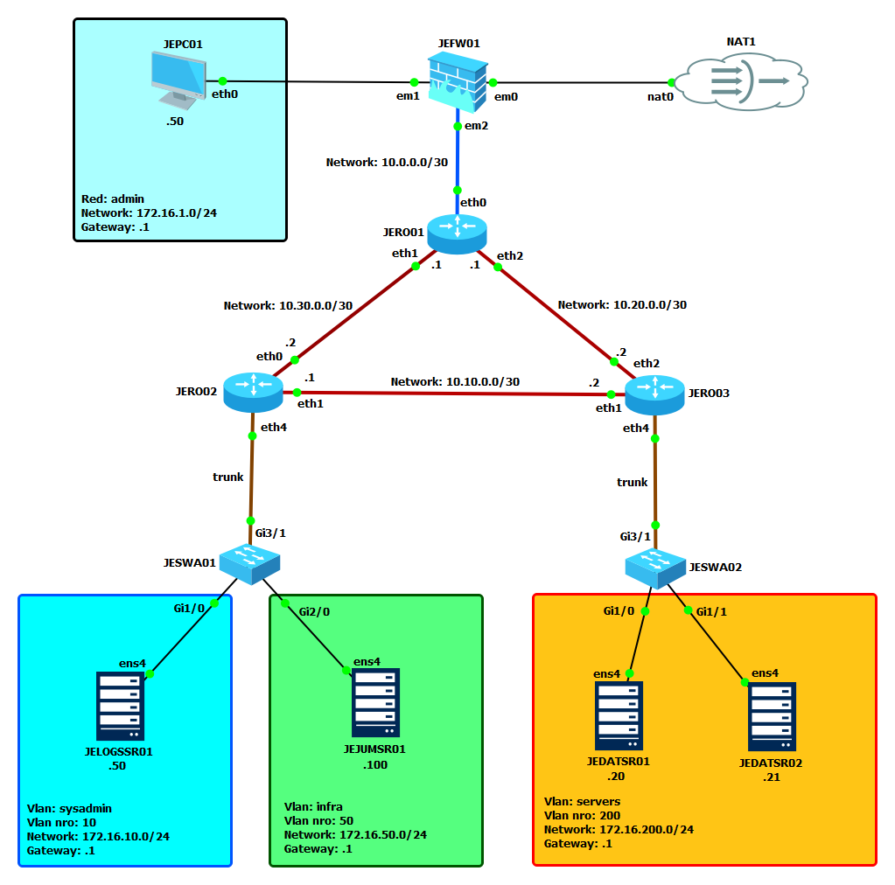
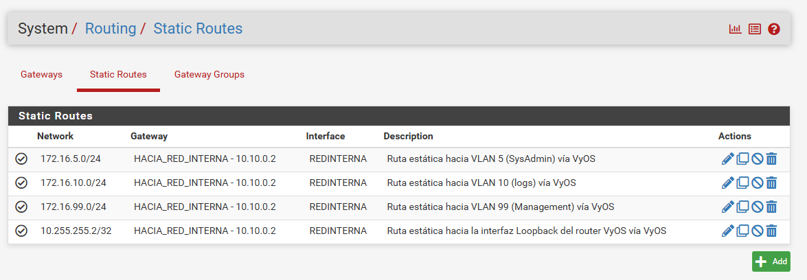

# Direccionamiento y topología de Red

## Topología

- Tres routers VyOS en triángulo: JERO01 hace de core y es el único con enlace al firewall (JEFW01). JERO02 y JERO03 hacen de distribución.
- Routing inter-VLAN distribuido: cada router de distribución es el gateway de las VLANs de su switch de acceso, con router-on-a-stick sobre subinterfaces 802.1Q (`eth4`).
- Switching puramente L2 en JESWA01 (detrás de JERO02) y JESWA02 (detrás de JERO03).
- 3 VLANs: Sysadmin (10), Infra (50), Servers (200).

## Direccionamiento

### Subredes

| Red             | Descripción                 | Gateway      | Vlan ID |
| --------------- | --------------------------- | ------------ | ------- |
| 10.0.0.0/30     | P2P JEFW01 ↔ JERO01         | —            | -       |
| 10.10.0.0/30    | P2P JERO02 ↔ JERO03         | —            | -       |
| 10.20.0.0/30    | P2P JERO01 ↔ JERO03         | —            | -       |
| 10.30.0.0/30    | P2P JERO01 ↔ JERO02         | —            | -       |
| 172.16.1.0/24   | Admin                       | 172.16.1.1   | -       |
| 172.16.10.0/24  | VLAN 10 Sysadmin            | 172.16.10.1  | 10      |
| 172.16.50.0/24  | VLAN 50 Infra               | 172.16.50.1  | 50      |
| 172.16.200.0/24 | VLAN 200 Servers            | 172.16.200.1 | 200     |
| 1.1.1.1/32      | Interfaz de loopback JERO01 | -            | -       |
| 2.2.2.2/32      | Interfaz de loopback JERO02 | -            | -       |
| 3.3.3.3/32      | Interfaz de loopback JERO03 | -            | -       |

---

### VLANs

| VLAN | Nombre     | Gateway (router) | Asignación                                             |
| ---- | ---------- | ---------------- | ------------------------------------------------------ |
| 10   | Sysadmin   | JERO02 eth4.10   | Access en JESWA01 Gi1/0 → JELOGSSR01                   |
| 50   | Infra      | JERO02 eth4.50   | Access en JESWA01 Gi2/0 → JEJUMSR01                    |
| 200  | Servers    | JERO03 eth4.200  | Access en JESWA02 Gi1/0 → JEDATSR01, Gi1/1 → JEDATSR02 |
| 98   | Management | JERO03 eth4.98   | Vlan 98 de management JESWA02                          |
| 99   | Management | JERO02 eth4.99   | Vlan 98 de management JESWA01                          |

---

### Direccionamiento por dispositivo

| Dispositivo      | Rol                 | Interfaz    | IP               | Red                          |
| ---------------- | ------------------- | ----------- | ---------------- | ---------------------------- |
| JEFW01 (pfSense) | Firewall borde      | em0         | DHCP             | WAN → NAT1                   |
|                  |                     | loopback lo | 10.255.255.1/32  | Interfaz de loopback pfSense |
|                  |                     | em1         | 172.16.1.1/24    | Management                   |
|                  |                     | em2         | 10.0.0.1/30      | P2P → JERO01                 |
| JERO01 (VyOS)    | Router core         | eth0        | 10.0.0.2/30      | P2P → JEFW01                 |
|                  |                     | loopback lo | 10.255.255.2/32  | Interfaz de loopback JERO01  |
|                  |                     | eth1        | 10.30.0.1/30     | P2P → JERO02                 |
|                  |                     | eth2        | 10.20.0.1/30     | P2P → JERO03                 |
| JERO02 (VyOS)    | Router distribución | eth0        | 10.30.0.2/30     | P2P → JERO01                 |
|                  |                     | eth1        | 10.10.0.1/30     | P2P → JERO03                 |
|                  |                     | eth4        | trunk 802.1Q     | → JESWA01                    |
|                  |                     | eth4.10     | 172.16.10.1/24   | VLAN 10 gateway              |
|                  |                     | eth4.50     | 172.16.50.1/24   | VLAN 50 gateway              |
| JERO03 (VyOS)    | Router distribución | eth2        | 10.20.0.2/30     | P2P → JERO01                 |
|                  |                     | eth1        | 10.10.0.2/30     | P2P → JERO02                 |
|                  |                     | eth4        | trunk 802.1Q     | → JESWA02                    |
|                  |                     | eth4.200    | 172.16.200.1/24  | VLAN 200 gateway             |
| JESWA01          | Access switch (L2)  | Gi3/1       | trunk            | → JERO02                     |
|                  |                     | Gi1/0       | access VLAN 10   | → JELOGSSR01                 |
|                  |                     | Gi2/0       | access VLAN 50   | → JEJUMSR01                  |
| JESWA02          | Access switch (L2)  | Gi3/1       | trunk            | → JERO03                     |
|                  |                     | Gi1/0       | access VLAN 200  | → JEDATSR01                  |
|                  |                     | Gi1/1       | access VLAN 200  | → JEDATSR02                  |
| JELOGSSR01       | rsyslog collector   | ens4        | 172.16.10.50/24  | VLAN 10                      |
| JEJUMSR01        | Bastion/jump        | ens4        | 172.16.50.100/24 | VLAN 50                      |
| JEDATSR01        | Servidor            | ens4        | 172.16.200.20/24 | VLAN 200                     |
| JEDATSR02        | Servidor            | ens4        | 172.16.200.21/24 | VLAN 200                     |
| JEPC01           | Cliente interno     | eth0        | 172.16.1.50/24   | Admin                        |

<!-- VERIFICAR: el diagrama no muestra qué lado del 10.0.0.0/30 es .1 y cuál .2; asumí em2 = .1 y JERO01 eth0 = .2. -->

---

## Routing

**JERO01 (VyOS)**: `show ip route`

| Red Destino    | Máscara / CIDR | Gateway Siguiente Salto | Interfaz | Distancia Admin.   |
| :------------- | :------------- | :---------------------- | :------- | :----------------- |
| `0.0.0.0`      | `/0`           | `10.0.0.1`              | `eth0`   | 1 (static)         |
| `10.0.0.0`     | `/30`          | conectada               | `eth0`   | 0                  |
| `10.30.0.0`    | `/30`          | conectada               | `eth1`   | 0                  |
| `10.20.0.0`    | `/30`          | conectada               | `eth2`   | 0                  |
| `172.16.10.0`  | `/24`          | `10.30.0.2`             | `eth1`   | <!-- VERIFICAR --> |
| `172.16.50.0`  | `/24`          | `10.30.0.2`             | `eth1`   | <!-- VERIFICAR --> |
| `172.16.200.0` | `/24`          | `10.20.0.2`             | `eth2`   | <!-- VERIFICAR --> |

**JERO02 (VyOS)**: `show ip route`

| Red Destino    | Máscara / CIDR | Gateway Siguiente Salto | Interfaz  | Distancia Admin.   |
| :------------- | :------------- | :---------------------- | :-------- | :----------------- |
| `0.0.0.0`      | `/0`           | `10.30.0.1`             | `eth0`    | <!-- VERIFICAR --> |
| `10.30.0.0`    | `/30`          | conectada               | `eth0`    | 0                  |
| `10.10.0.0`    | `/30`          | conectada               | `eth1`    | 0                  |
| `172.16.10.0`  | `/24`          | conectada               | `eth4.10` | 0                  |
| `172.16.50.0`  | `/24`          | conectada               | `eth4.50` | 0                  |
| `172.16.200.0` | `/24`          | `10.10.0.2`             | `eth1`    | <!-- VERIFICAR --> |

**JERO03 (VyOS)**: `show ip route`

| Red Destino    | Máscara / CIDR | Gateway Siguiente Salto | Interfaz   | Distancia Admin.   |
| :------------- | :------------- | :---------------------- | :--------- | :----------------- |
| `0.0.0.0`      | `/0`           | `10.20.0.1`             | `eth2`     | <!-- VERIFICAR --> |
| `10.20.0.0`    | `/30`          | conectada               | `eth2`     | 0                  |
| `10.10.0.0`    | `/30`          | conectada               | `eth1`     | 0                  |
| `172.16.200.0` | `/24`          | conectada               | `eth4.200` | 0                  |
| `172.16.10.0`  | `/24`          | `10.10.0.1`             | `eth1`     | <!-- VERIFICAR --> |
| `172.16.50.0`  | `/24`          | `10.10.0.1`             | `eth1`     | <!-- VERIFICAR --> |

<!-- VERIFICAR: completar distancia admin. según el protocolo real (static = 1, OSPF = 110) y corregir next-hops con la salida de `show ip route` de cada router. -->

**JEFW01 (pfSense)**: System → Routing

<!-- VERIFICAR: la captura es de la topología anterior; reemplazarla. Las rutas a 172.16.10/50/200.0/24 deberían apuntar a 10.0.0.2 (JERO01). -->

El ruteo entre VLANs ya no está centralizado en un único router. Las VLANs 10 y 50 se rutean localmente en JERO02. El tráfico hacia la VLAN 200 cruza el enlace JERO02 ↔ JERO03, y todo lo que sale a internet pasa por JERO01 hacia JEFW01.
